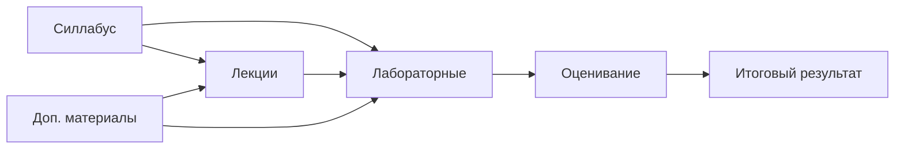

# Учебный репозиторий дисциплины "Основы программирования"

## Быстрая навигация

| Раздел                                | Назначение                                                    |
|---------------------------------------|---------------------------------------------------------------|
| [Силлабус](syllabus/README.md)        | цели, результаты обучения, политика курса, календарь          |
| [Лекции](lectures/README.md)          | конспекты, материалы до/после занятия                         |
| [Лабораторные](labs/README.md)        | задания, критерии, шаблоны отчета                             |
| [Доп. материалы](materials/README.md) | справочники, статьи, практики                                 |
| [Оценивание](assessment/README.md)    | рубрики, контрольные точки, итоговая схема                    |
| [Метаданные](meta/README.md)          | соглашения по структуре и Markdown                            |
| [Решения](solutions/README.md)        | исходный код и отчеты обучающихся в рамках лабораторных работ |

## Рекомендуемая стратегия использования шаблона в рамках дисциплины

1. Каждый обучающийся на основе репозитория дисциплины создает свой собственный **публичный** репозиторий, через механизм ответвления (Fork). Для этого студентам необходимо нажать на соответствующую кнопку в группе кнопок справа от названия репозитория.
2. Обучающиеся **в своих отдельных репозиториях**, созданных через ответвление, выполняют лабораторные работы в директории `solutions`, куда также выгружают отчеты и дублируют их на почту преподавателю.

## Карта курса

