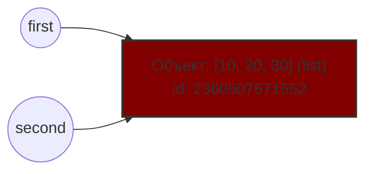
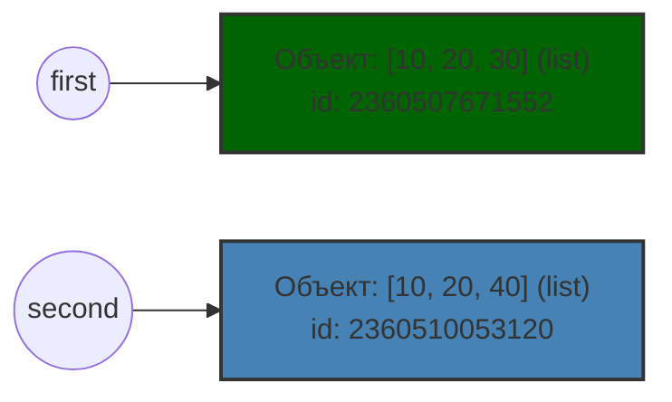
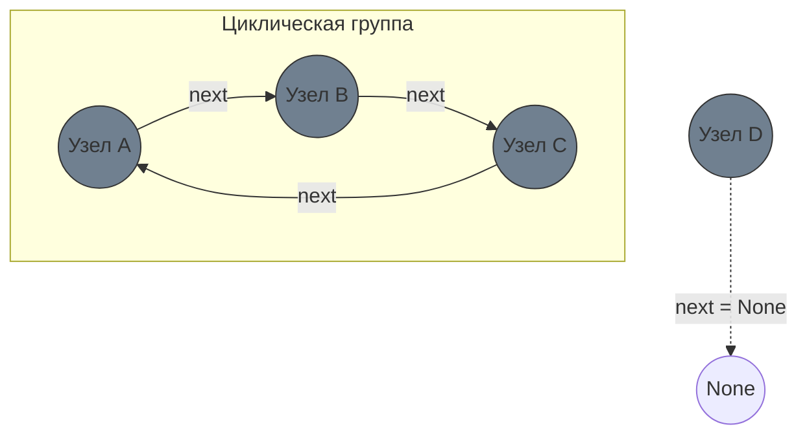

# Цель работы
### Исследовать связь между именами и объектами, понять различия между присваиванием, поверхностным и глубоким копированием, а также познакомиться с механизмами управления памятью в CPython.

# Задание 1. Имена, ссылки и изменяемость
### 1.1 Объясните, почему после операции `a += 1` значение, связанное с именем `b`, не изменилось.   
В Python целые числа (тип `int`) являются неизменяемыми объектами. При выполнении `b = a` имя `b` начинают ссылаться на тот же объект в памяти (число 10), что и `a`. Операция `a += 1` для неизменяемого типа эквивалентна `a = a + 1`. При вычислении a + 1 Python создаёт в памяти новый объект (число 11) и связывает имя `a` с ним. Имя `b` при этом остается связанным с исходным объектом 10, поэтому его значение не меняется.

### Вывод программы (эксперименты A, B):


#### Схема 1. Связи до переназначения (один общий объект)


#### Схема 2. Связи после переназначения (разные независимые объекты)


### Практическая задача:


### Вопросы для анализа
#### 1. Меняет ли присваивание ```second = first``` сам объект?
Нет, присваивание всего лишь дает ссылку переменной `second` на ту же ячейку памяти, что и `first`.

#### 2. Почему операция над неизменяемым объектом приводит к связыванию имени с другим объектом?
Неизменяемые объекты (`int`, `str`, `tuple`, `float`) по определению не могут быть модифицированы на месте в памяти. Любое изменение значения такого объекта, заставляет Python: вычислить новое значение, создать для него новый объект в памяти и связать имя переменной с этим новым объектом.

#### 3. Как определить, что два имени обозначают один объект?
Оператором `is`: выражение `a is b` возвращает True, если оба имени ссылаются на один и тот же объект в память или функцией `id()`: сравнение адресов объектов в памяти `id(a) == id(b)`. (Оператор `==` проверяет лишь эквивалентность)


# Задание 2. Поверхностное и глубокое копирование
### Вывод программы 2.1:
 


| Операция | Новый внешний объект | Новые вложенные объекты | Изменения независимы |
|---|---|---|---|
| Присваивание | нет | нет | нет (для всех уровней) |
| Поверхностная копия | да | нет | только для внешнего уровня |
| Глубокая копия | да | да | да (на всех уровнях) |

## Объяснение wrong_matrix:
#### Операция `[[0] * 3]` создает один вложенный список. Внешняя операция `* 3` не создает три новых списка, а создает три ссылки на этот единственный объект в памяти.
#### Если проверить их идентичность через `id()`, мы увидим, что все строки - это один и тот же объект: 


#### Поэтому изменение элемента в нулевом элементе нулевой строки (`wrong_matrix[0][0] = 1`) меняет общий объект, что мгновенно отражается на всех строках.

## Объяснение correct_matrix:
#### Генератор списка (`for _ in range(3)`) выполняет выражение `[0] * 3` три раза. На каждой итерации в памяти создается новый, независимый вложенный список.
#### Проверка идентичности показывает разные адреса в памяти:


#### Изменение элемента в первой строке затрагивает только её собственный объект в памяти, оставляя остальные строки нетронутыми.

## Вопросы для анализа

### 1. Чем поверхностная копия отличается от глубокой?
#### В поверхностной копии при изменении независимыми будут только элементы первого уровня, на элементы остальных уровней поверхностная копия просто копирует ссылку на уже существующие объекты.
#### Глубокая копия копирует все элементы всех уровней, делая их независимыми.

### 2. Почему глубокое копирование не следует применять автоматически ко всем объектам?
 1. Глубокое копирование требует больше памяти.
 2. Некоторые объекты просто не могут быть скопированы в силу своих свойств.
 3. Могут попасться циклические ссылки, что приведет к непредсказуемым результатам
 4. Иногда нужно и полезно, чтобы вложенные объекты не 1 уровня оставались общими, для обращения к ним.

### 3. В каких случаях достаточно поверхностной копии?
 1. Если объекты внутри списка неизменяемые
 2. Нужно изменить только верхний уровень
 3. Требуется разделить вложенные данные 

# Задание 3. Подсчет ссылок и время жизни объекта
## Объяснение результатов
### Почему `sys.getrefcount()` показывает на одну ссылку больше?
#### Когда вызывается `sys.getrefcount(data)`, объект `data` передается в функцию как аргумент. В момент вызова функции создается временная ссылка на этот объект. Поэтому счетчик всегда показывает реальное количество ссылок + 1. Как только функция завершается, временная ссылка исчезает.


### Какие инструкции увеличивают счетчик?
 1. Присваивание.
 2. Добавление объекта в контейнер.
 3. Передача объекта в функцию как аргумент.
 4. Возврат объекта из функции.

### Какие инструкции уменьшают счетчик?
 1. `del`.
 2. Переназначение переменной.
 3. Удаление элемента из контейнера.
 4. Выход объекта из области видимости.

### Почему `del alias` удаляет имя, а не объект?
#### Инструкция `del` просто убирает ярлык с объекта, а не удаляет его. Таким образом, счетчик ссылок уменьшается на 1. Если счетчик ссылок падает до нуля, сборщик мусора автоматически освобождает память.

## Слабые ссылки (weakref)


### Почему слабая ссылка не продлевает время жизни?
#### Слабая ссылка (weakref) указывает на объект, но не увеличивает его счетчик ссылок. Сборщик мусора в Python игнорирует слабые ссылки при подсчете достижимости объекта. Если на объект остаются только слабые ссылки и счетчик сильных ссылок равен 0, объект уничтожается. После уничтожения слабая ссылка автоматически возвращает None.

### Пример полезного применения
#### При кэшировании больших объектов, если использовать обычный словарь, кэш будет держать объекты в памяти вечно, даже если они больше не нужны основной программе, что приведет к утечке памяти.
#### Используя `WeakValueDictionary`, кэш будет хранить объекты только до тех пор, пока они используются где-то еще в коде. Как только программа перестанет использовать объект, он удалится, и запись автоматически исчезнет из кэша.

## Практическая задача: Слабый реестр


#### В коде был создан `WeakValueDictionary`. Когда был удален `obj3`, объект `C` был уничтожен, и словарь автоматически удалил ключ `key3`.
#### Когда был удален `obj2`, объект `B` также был уничтожен, и ключ `key2` исчез.
#### В словаре остался только `obj1` (`A`), так как на него все еще существует сильная ссылка в переменной obj1.
#### Вывод: `WeakValueDictionary` не управляет временем жизни объектов. Он только наблюдает за ними и автоматически очищает себя от устаревших записей.

## Вопросы для анализа
### 1. При каком условии подсчет ссылок позволяет освободить объект?
####     Если не осталось сильных ссылок на объект, то GC удаляет его. Слабые ссылки не считаются поводом для сохранения объекта.

### 2. Всегда ли освобождение Python-объекта означает немедленный возврат памяти операционной системе?
####     Нет, память возвращается во внутренний пул Python для повторного использования, а не ОС.

### 3. Чем сильная ссылка отличается от слабой?
#### Сильная ссылка: не дает удалить объект, увеличивает счетчик ссылок.
####     Слабая ссылка: не удерживает объект в памяти, не увеличивает счетчик ссылок.

# Задание 4. Циклические ссылки и сборщик мусора


## 4.1
### Объясните, почему одного подсчета ссылок недостаточно для удаления созданного цикла.
#### Когда выполнилось `del first, second`, внешние ссылки на эти списки исчезли. Но внутри first хранится ссылка на `second`, поэтому счетчик ссылок `second` = 1, а внутри `second` хранится ссылка на `first` и счетчик ссылок `first` = 1. Механизм подсчета ссылок видит, что счетчики не равны нулю, и считает объекты использующимися. Но так как внешних ссылок на эти списки нет, то они считаются мусором, но не могут быть удалены из-за циклического ссылания друг на друга.

### Объясните назначение поколений сборщика мусора без привязки к конкретным значениям порогов.
#### Все объекты делятся на три поколения в связи с гипотезой о слабых поколениях: "большинство объектов умирают быстро после создания". Таким образом, новые объекты попадают в поколение 0, для которого сборщик мусора запускается чаще всего. Если обхект выжил в нем, то он попадает в поколение 1. Если выжил и в нем, то в поколение 2. Это позволяет GC экономить время на проверке объектов.

## 4.2 


## 4.3 mermaid диаграмма

## Сопоставление с кодом и результаты
#### Были созданы 4 словаря (`node_a`, `node_b`, `node_c`, `node_d`). Словари в Python поддерживают циклические ссылки, поэтому они автоматически добавляются под наблюдение GC.
#### Команда `del node_a, node_b, node_c` удаляет имена из локальной области видимости. Словари `A`, `B` и `C` остаются в памяти, так как ссылаются друг на друга через ключ `next`.
#### Вызов `gc.collect()` заставляет алгоритм поиска циклов просканировать память. Он обнаруживает изолированный кластер из 3 словарей, понимает, что до них нельзя добраться из корневых ссылок, и удаляет их.
#### `gc.collect()` возвращает число собранных объектов (в данном случае 3: словари `A`, `B` и `C`).
#### Словарь D не входил в цикл и на него осталась сильная внешняя ссылка (`node_d`), поэтому сборщик мусора его не тронул.


## Вопросы для анализа

### 1. Как возникает циклическая ссылка?
#### Циклическая ссылка возникает, когда два или более объектов содержат прямые или косвенные ссылки друг на друга, образуя замкнутый контур.

### 2. Почему объект с ненулевым счетчиком ссылок иногда может быть недостижим из программы?
#### Если внешняя программа удалила все переменные, которые ссылались на этот объект и не видит его, то для обычного счетчика ссылок достаточно и внутреннего счетчика, который никогда не упадет до нуля из-за цикла. Поэтому он и не может удалить этот объект.

### 3. Зачем сборщик мусора разделяет отслеживаемые объекты по поколениям?
#### Чтобы оптимизировать сбор мусора. Так как в основном только что созданные объекты живут недолго, надо прежде всего проверять их, поэтому есть 3 поколения: на 0 идут основные затраты (после разницы в 2000 между удаленными и созданными), на 1 меньше (после 10 сборок 0 поколения), на 2 - полная проверка (после 10 сборок 1 поколения)

# Задание 5. Исследование потребления памяти
## 5.1 Размер отдельных объектов


### Объясните, почему размер контейнера не обязательно включает полный размер всех объектов, на которые он ссылается.
Функция `sys.getsizeof()` возвращает только размер обертки и массива ссылок на объекты без размера самих обеъктов.

## 5.2 Рост списка


#### увеличивается ли размер списка после каждого `append()`;
Нет, увеличивается скачками.

#### почему список резервирует место с запасом;
Чтобы операция `append()` была за $O(1)$, иначе бы пришлось при добавлении каждого нового элемента, копировать все старые в новый блок памяти, что сделало бы операцию за $O(n)$.

#### чем длина списка отличается от объема выделенной памяти.
Длина - это фактическое количество элементов в списке. Объем выделенной памяти - это количество слотов, под которые ОС выделила память. Он всегда больше или равен длине.

## 5.3 Измерение через `tracemalloc`


Вывод: `list(range(100_000))` - это материализованная последовательность. Физически создается 100000 объектов int и массив из 100000 указателей на них. Это требует мегабайтов оперативной памяти.

`range(100_000)` - это объект, который хранит правило. Он занимает фиксированный небольшой объем памяти, так как хранит только три числа: start, stop и step.

Таким образом, очевидно, что объект-правило гораздо экономнее использует память, но может быть не так удобен как материализованный объект.

## Итоговый анализ. Способы уменьшения потребления памяти:
#### 1. Использование генераторов (`(x*x for _ in range(10**6))`) вместо списков (`[x*x for _ in range(10**6)]`), чтобы хранить правило получения объектов, что занимает гораздо меньше места. 
#### 2. Замена списков на неизменяемые типа данных (если подходит по задаче), например `list()` -> `tuple()`, кортежи занимают меньше места, чем списки. 
#### 3. Использование слабых ссылок, например, для словарей. Если в коде эта структура уже будет не нужна, то gc отчистит ее, и она не будет занимать лишнюю память.

## 5.4 Практическая задача


