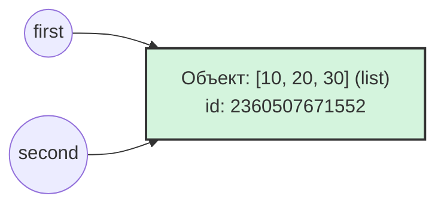
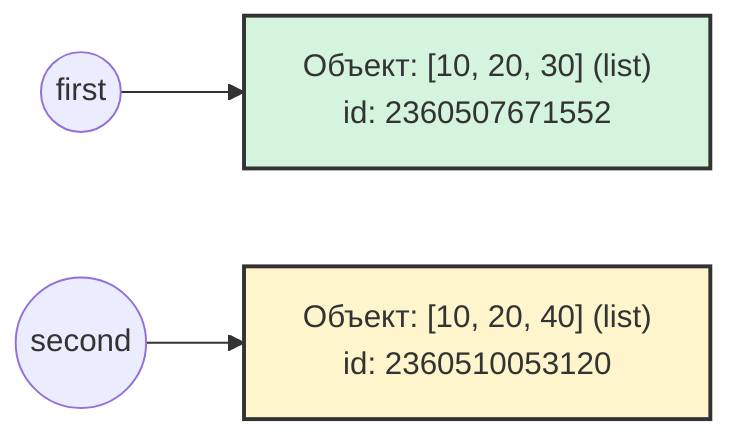

# Цель работы
### Исследовать связь между именами и объектами, понять различия между присваиванием, поверхностным и глубоким копированием, а также познакомиться с механизмами управления памятью в CPython.

# Задание 1. Имена, ссылки и изменяемость
### 1.1 Объясните, почему после операции `a += 1` значение, связанное с именем `b`, не изменилось.   
В Python целые числа (тип `int`) являются неизменяемыми объектами. При выполнении `b = a` имя `b` начинают ссылаться на тот же объект в памяти (число 10), что и `a`. Операция `a += 1` для неизменяемого типа эквивалентна `a = a + 1`. При вычислении a + 1 Python создаёт в памяти новый объект (число 11) и связывает имя `a` с ним. Имя `b` при этом остается связанным с исходным объектом 10, поэтому его значение не меняется.

#### Схема 1. Связи до переназначения (один общий объект)


#### Схема 2. Связи после переназначения (разные независимые объекты)


### Вопросы для анализа
#### 1. Меняет ли присваивание ```second = first``` сам объект?
Нет, присваивание всего лишь дает ссылку переменной `second` на ту же ячейку памяти, что и `first`.

#### 2. Почему операция над неизменяемым объектом приводит к связыванию имени с другим объектом?
Неизменяемые объекты (`int`, `str`, `tuple`, `float`) по определению не могут быть модифицированы на месте в памяти. Любое изменение значения такого объекта, заставляет Python: вычислить новое значение, создать для него новый объект в памяти и связать имя переменной с этим новым объектом.

#### 3. Как определить, что два имени обозначают один объект?
Оператором `is`: выражение `a is b` возвращает True, если оба имени ссылаются на один и тот же объект в память или функцией `id()`: сравнение адресов объектов в памяти `id(a) == id(b)`. (Оператор `==` проверяет лишь эквивалентность)


# Задание 2. Поверхностное и глубокое копирование

| Операция | Новый внешний объект | Новые вложенные объекты | Изменения независимы |
|---|---|---|---|
| Присваивание | нет | нет | нет (для всех уровней) |
| Поверхностная копия | да | нет | только для внешнего уровня |
| Глубокая копия | да | да | да (на всех уровнях) |

### Объяснение wrong_matrix:
#### Операция `[[0] * 3]` создает один вложенный список. Внешняя операция `* 3` не создает три новых списка, а создает три ссылки на этот единственный объект в памяти.
#### Если проверить их идентичность через `id()`, мы увидим, что все строки - это один и тот же объект: 


#### Поэтому изменение элемента в нулевом элементе нулевой строки (`wrong_matrix[0][0] = 1`) меняет общий объект, что мгновенно отражается на всех строках.

### Объяснение correct_matrix:
#### Генератор списка (`for _ in range(3)`) выполняет выражение `[0] * 3` три раза. На каждой итерации в памяти создается новый, независимый вложенный список.
#### Проверка идентичности показывает разные адреса в памяти:


#### Изменение элемента в первой строке затрагивает только её собственный объект в памяти, оставляя остальные строки нетронутыми.

### Вопросы для анализа

#### 1. Чем поверхностная копия отличается от глубокой?
##### В поверхностной копии при изменении независимыми будут только элементы первого уровня, на элементы остальных уровней поверхностная копия просто копирует ссылку на уже существующие объекты.
##### Глубокая копия копирует все элементы всех уровней, делая их независимыми.

#### 2. Почему глубокое копирование не следует применять автоматически ко всем объектам?
##### 1. Глубокое копирование требует больше памяти.
##### 2. Некоторые объекты просто не могут быть скопированы в силу своих свойств.
##### 3. Могут попасться циклические ссылки, что приведет к непредсказуемым результатам
##### 4. Иногда нужно и полезно, чтобы вложенные объекты не 1 уровня оставались общими, для обращения к ним.

#### 3. В каких случаях достаточно поверхностной копии?
##### 1. Если объекты внутри списка неизменяемые
##### 2. Нужно изменить только верхний уровень
##### 3. Требуется разделить вложенные данные 

# Задание 3. Подсчет ссылок и время жизни объекта
## Объяснение результатов
### Почему `sys.getrefcount()` показывает на одну ссылку больше?
#### Когда вызывается `sys.getrefcount(data)`, объект `data` передается в функцию как аргумент. В момент вызова функции создается временная ссылка на этот объект. Поэтому счетчик всегда показывает реальное количество ссылок + 1. Как только функция завершается, временная ссылка исчезает.

### Какие инструкции увеличивают счетчик?
#### 1. Присваивание.
#### 2. Добавление объекта в контейнер.
#### 3. Передача объекта в функцию как аргумент.
#### 4. Возврат объекта из функции.

### Какие инструкции уменьшают счетчик?
#### 1. `del`.
#### 2. Переназначение переменной.
#### 3. Удаление элемента из контейнера.
#### 4. Выход объекта из области видимости.

### Почему `del alias` удаляет имя, а не объект?
#### Инструкция `del` просто убирает ярлык с объекта, а не удаляет его. Таким образом, счетчик ссылок уменьшается на 1. Если счетчик ссылок падает до нуля, сборщик мусора автоматически освобождает память.

## Слабые ссылки (weakref)

### Почему слабая ссылка не продлевает время жизни?
#### Слабая ссылка (weakref) указывает на объект, но не увеличивает его счетчик ссылок. Сборщик мусора в Python игнорирует слабые ссылки при подсчете достижимости объекта. Если на объект остаются только слабые ссылки и счетчик сильных ссылок равен 0, объект уничтожается. После уничтожения слабая ссылка автоматически возвращает None.

### Пример полезного применения
#### При кэшировании больших объектов, если использовать обычный словарь, кэш будет держать объекты в памяти вечно, даже если они больше не нужны основной программе, что приведет к утечке памяти.
#### Используя `WeakValueDictionary`, кэш будет хранить объекты только до тех пор, пока они используются где-то еще в коде. Как только программа перестанет использовать объект, он удалится, и запись автоматически исчезнет из кэша.

## Практическая задача: Слабый реестр
#### В коде я создал `WeakValueDictionary`. Когда был удален `obj3`, объект `C` был уничтожен, и словарь автоматически удалил ключ `key3`.
#### Когда был удален `obj2`, объект `B` также был уничтожен, и ключ `key2` исчез.
#### В словаре остался только `obj1` (`A`), так как на него все еще существует сильная ссылка в переменной obj1.
#### Вывод: `WeakValueDictionary` не управляет временем жизни объектов. Он только наблюдает за ними и автоматически очищает себя от устаревших записей.

## Вопросы для анализа
### 1. При каком условии подсчет ссылок позволяет освободить объект?
#### Если не осталось сильных ссылок на объект, то GC удаляет его. Слабые ссылки не считаются поводом для сохранения объекта.

### 2. Всегда ли освобождение Python-объекта означает немедленный возврат памяти операционной системе?
#### Нет, память возвращается во внутренний пул Python для повторного использования, а не ОС.

### 3. Чем сильная ссылка отличается от слабой?
#### Сильная ссылка: не дает удалить объект, увеличивает счетчик ссылок.
#### Слабая ссылка: не удерживает объект в памяти, не увеличивает счетчик ссылок.

# Задание 4. Циклические ссылки и сборщик мусора


## 4.1
### Объясните, почему одного подсчета ссылок недостаточно для удаления созданного цикла.
#### Когда выполнилось `del first, second`, внешние ссылки на эти списки исчезли. Но внутри first хранится ссылка на `second`, поэтому счетчик ссылок `second` = 1, а внутри `second` хранится ссылка на `first` и счетчик ссылок `first` = 1. Механизм подсчета ссылок видит, что счетчики не равны нулю, и считает объекты использующимися. Но так как внешних ссылок на эти списки нет, то они считаются мусором, но не могут быть удалены из-за циклического ссылания друг на друга.

### Объясните назначение поколений сборщика мусора без привязки к конкретным значениям порогов.
#### Все объекты делятся на три поколения в связи с гипотезой о слабых поколениях: "большинство объектов умирают быстро после создания". Таким образом, новые объекты попадают в поколение 0, для которого сборщик мусора запускается чаще всего. Если обхект выжил в нем, то он попадает в поколение 1. Если выжил и в нем, то в поколение 2. Это позволяет GC экономить время на проверке объектов.

## 4.3
``` mermaid
graph TD
    A((Узел A)) -->|next| B((Узел B))
    B -->|next| C((Узел C))
    C -->|next| A
    
    D((Узел D)) -.->|next = None| Null((None))

    %% Подсветка циклической группы
    subgraph Циклическая группа (уничтожена GC)
        A
        B
        C
    end
    
    style A fill:#f9d0c4,stroke:#333
    style B fill:#f9d0c4,stroke:#333
    style C fill:#f9d0c4,stroke:#333
    style D fill:#d4f4dd,stroke:#333
```
## Сопоставление с кодом и результаты
#### Создание: я создал 4 словаря (`node_a`, `node_b`, `node_c`, `node_d`). Словари в Python поддерживают циклические ссылки, поэтому они автоматически добавляются под наблюдение GC.
#### Удаление внешних ссылок: команда `del node_a, node_b, node_c` удаляет имена из локальной области видимости. Словари `A`, `B` и `C` остаются в памяти, так как ссылаются друг на друга через ключ `next`.
#### Ручная сборка: вызов `gc.collect()` заставляет алгоритм поиска циклов просканировать память. Он обнаруживает изолированный кластер из 3 словарей, понимает, что до них нельзя добраться из корневых ссылок, и удаляет их.
#### Результат: `gc.collect()` возвращает число собранных объектов (в данном случае 3, так как были собраны только словари `A`, `B` и `C`.
#### Независимый узел: Словарь D не входил в цикл и на него осталась сильная внешняя ссылка (node_d). Сборщик мусора его не тронул.
