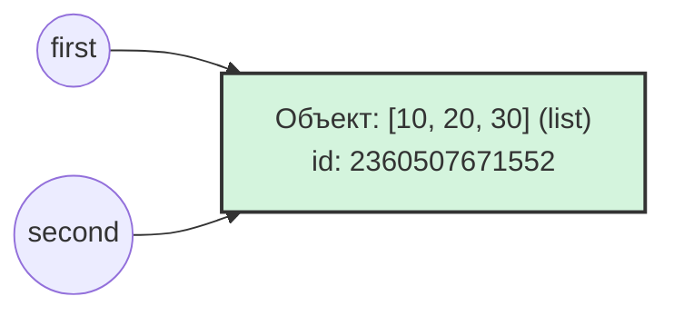
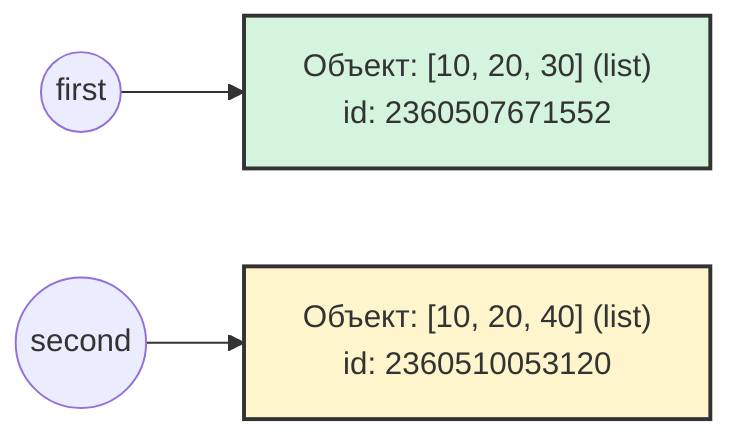

# Цель работы
### Исследовать связь между именами и объектами, понять различия между присваиванием, поверхностным и глубоким копированием, а также познакомиться с механизмами управления памятью в CPython.

# Задание 1. Имена, ссылки и изменяемость
### 1.1 Объясните, почему после операции `a += 1` значение, связанное с именем `b`, не изменилось.   
В Python целые числа (тип `int`) являются неизменяемыми объектами. При выполнении `b = a` имя `b` начинают ссылаться на тот же объект в памяти (число 10), что и `a`. Операция `a += 1` для неизменяемого типа эквивалентна `a = a + 1`. При вычислении a + 1 Python создаёт в памяти новый объект (число 11) и связывает имя `a` с ним. Имя `b` при этом остается связанным с исходным объектом 10, поэтому его значение не меняется.

#### Схема 1. Связи до переназначения (один общий объект)


#### Схема 2. Связи после переназначения (разные независимые объекты)


### Вопросы для анализа
#### 1. Меняет ли присваивание ```second = first``` сам объект?
Нет, присваивание всего лишь дает ссылку переменной `second` на ту же ячейку памяти, что и `first`.

#### 2. Почему операция над неизменяемым объектом приводит к связыванию имени с другим объектом?
Неизменяемые объекты (`int`, `str`, `tuple`, `float`) по определению не могут быть модифицированы на месте в памяти. Любое изменение значения такого объекта, заставляет Python: вычислить новое значение, создать для него новый объект в памяти и связать имя переменной с этим новым объектом.

#### 3. Как определить, что два имени обозначают один объект?
Оператором `is`: выражение `a is b` возвращает True, если оба имени ссылаются на один и тот же объект в память или функцией `id()`: сравнение адресов объектов в памяти `id(a) == id(b)`. (Оператор `==` проверяет лишь эквивалентность)


# 


| Операция | Новый внешний объект | Новые вложенные объекты | Изменения независимы |
|---|---|---|---|
| Присваивание |  |  |  |
| Поверхностная копия |  |  |  |
| Глубокая копия |  |  |  |
